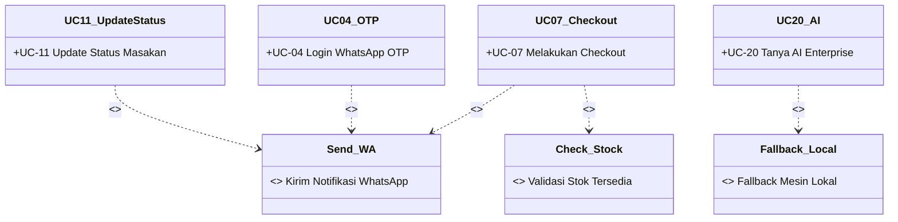

# DOKUMENTASI SPESIFIKASI USE CASE
## Sistem Pemesanan Kuliner & Manajemen UMKM "Baso & Mie Ayam Ojolali"

Dokumen ini mendeskripsikan secara lengkap pemodelan fungsionalitas sistem berbasis **Use Case Diagram** dan **Use Case Specifications** untuk platform web **Baso & Mie Ayam Ojolali**.

---

## 1. Gambaran Umum Sistem

Aplikasi web **Baso & Mie Ayam Ojolali** adalah sistem informasi manajemen restoran dan pemesanan online berbasis web terpadu yang memadukan:
- **E-Commerce & Pemesanan Mandiri Kuliner** bagi pelanggan (Dine-in & Take-away).
- **Point of Sale (POS) & Manajemen Antrean Dapur** bagi kasir.
- **Dashboard Analisis Bisnis & Rekap Keuangan** bagi administrator.
- **WhatsApp Notification Gateway (Fonnte API)** untuk pengiriman OTP dan status order otomatis.
- **Multi-Provider AI Assistant (Oji & Oji Enterprise)** yang terhubung langsung membaca database Prisma ORM secara real-time.

### Tumpukan Teknologi (Tech Stack)
- **Framework Utama:** Next.js (App Router, Turbopack, React Server Components)
- **Bahasa Pemrograman:** TypeScript, Node.js
- **Database & ORM:** MySQL 8.x dengan Prisma ORM
- **Autentikasi & Keamanan:** JWT (*jose*), bcryptjs password hashing, HTTP-Only Cookie
- **Antarmuka (UI):** Tailwind CSS, Lucide React
- **Integrasi Eksternal:** WhatsApp Gateway (Fonnte API), Multi-AI Provider (Google Gemini, Groq, OpenAI, DeepSeek, Anthropic)

---

## 2. Identifikasi & Profil Aktor

| No | Aktor | Tipe | Deskripsi & Hak Akses |
|---|---|---|---|
| 1 | **Pengunjung / Tamu (Guest)** | Pengguna | Masyarakat umum yang mengakses web tanpa login. Dapat melihat menu, mencari informasi warung, dan membuat akun. |
| 2 | **Pelanggan (Customer)** | Pengguna | Pengguna terdaftar yang memiliki akun. Dapat memesan menu, melacak antrean, menerima notifikasi WhatsApp, dan melihat riwayat belanja. |
| 3 | **Kasir (Cashier)** | Staf | Petugas operasional di warung. Bertanggung jawab memvalidasi pembayaran, memproses pesanan dapur, dan mengupdate status antrean. |
| 4 | **Administrator (Admin / Owner)** | Staf | Pemilik atau pengelola utama sistem. Memiliki hak akses penuh atas katalog produk, laporan keuangan, data pengguna, konfigurasi WhatsApp, dan AI. |
| 5 | **WhatsApp Gateway (Fonnte API)** | Sistem Eksternal | Layanan pihak ketiga untuk pengiriman pesan OTP login dan notifikasi status pesanan langsung ke nomor WhatsApp pengguna. |
| 6 | **AI Provider (Multi-LLM)** | Sistem Eksternal | Layanan kecerdasan buatan (Gemini/Groq/OpenAI/DeepSeek/Anthropic/Local) untuk memberi jawaban analisis bisnis dan asistensi interaktif. |

---

## 3. Diagram Use Case (UML Mermaid)

```mermaid
flowchart TD
    %% Aktor
    Guest["👤 Pengunjung / Tamu"]
    Customer["🧑‍💼 Pelanggan (Customer)"]
    Cashier["💼 Kasir (Cashier)"]
    Admin["👑 Administrator (Owner)"]
    WASys["📱 WhatsApp Gateway (Fonnte)"]
    AISys["🤖 AI Provider Engine"]

    subgraph "Modul Publik & Autentikasi"
        UC01([UC-01: Melihat Katalog Menu])
        UC02([UC-02: Registrasi Akun Pelanggan])
        UC03([UC-03: Login Kata Sandi / Shortcut])
        UC04([UC-04: Login WhatsApp OTP])
        UC05([UC-05: Konsultasi Chatbot AI Oji])
    end

    subgraph "Modul Pemesanan Pelanggan"
        UC06([UC-06: Mengelola Keranjang Belanja])
        UC07([UC-07: Melakukan Checkout & Pemesanan])
        UC08([UC-08: Melacak Status Antrean Pesanan])
        UC09([UC-09: Melihat Riwayat Pesanan])
    end

    subgraph "Modul Operasional Kasir"
        UC10([UC-10: Memantau Antrean Pesanan Dapur])
        UC11([UC-11: Memperbarui Status Pesanan])
        UC12([UC-12: Konfirmasi Pembayaran Pesanan])
    end

    subgraph "Modul Manajemen Administrator"
        UC13([UC-13: Memantau Dashboard Analitik])
        UC14([UC-14: Mengelola Produk & Kategori])
        UC15([UC-15: Mengontrol Stok Menu])
        UC16([UC-16: Mengelola Pengguna & Karyawan])
        UC17([UC-17: Laporan Keuangan & Omzet])
        UC18([UC-18: Konfigurasi WhatsApp Gateway])
        UC19([UC-19: Konfigurasi Multi-Provider AI])
        UC20([UC-20: Konsultasi Database AI Enterprise])
    end

    %% Relasi Aktor Tamu
    Guest --> UC01
    Guest --> UC02
    Guest --> UC03
    Guest --> UC04
    Guest --> UC05

    %% Relasi Aktor Pelanggan
    Customer --> UC01
    Customer --> UC05
    Customer --> UC06
    Customer --> UC07
    Customer --> UC08
    Customer --> UC09

    %% Relasi Aktor Kasir
    Cashier --> UC10
    Cashier --> UC11
    Cashier --> UC12

    %% Relasi Aktor Administrator
    Admin --> UC13
    Admin --> UC14
    Admin --> UC15
    Admin --> UC16
    Admin --> UC17
    Admin --> UC18
    Admin --> UC19
    Admin --> UC20

    %% Relasi Sistem Eksternal
    UC04 -.->|Kirim OTP| WASys
    UC07 -.->|Kirim Bukti Pesanan| WASys
    UC11 -.->|Kirim Status Siap| WASys
    UC05 -.->|Kueri LLM| AISys
    UC20 -.->|Kueri Data Real-time| AISys
```

---

## 4. Matriks Kebutuhan & Pembagian Use Case

| Kode UC | Nama Use Case | Aktor Terlibat | Hak Akses Minimal |
|---|---|---|---|
| **UC-01** | Melihat Katalog Menu & Detail Produk | Tamu, Pelanggan, Kasir, Admin | Publik |
| **UC-02** | Registrasi Akun Pelanggan Baru | Tamu | Publik |
| **UC-03** | Login Menggunakan Sandi & Shortcut | Tamu, Pelanggan, Kasir, Admin | Publik |
| **UC-04** | Login Cepat via WhatsApp OTP | Tamu, Pelanggan, Kasir, Admin | Publik |
| **UC-05** | Bertanya pada Chatbot AI Oji (Customer) | Tamu, Pelanggan | Publik |
| **UC-06** | Mengelola Keranjang Belanja (*Cart*) | Pelanggan | Customer |
| **UC-07** | Melakukan Checkout & Pemesanan | Pelanggan | Customer |
| **UC-08** | Melacak Status Antrean Pesanan | Pelanggan, Kasir, Admin | Customer |
| **UC-09** | Melihat Riwayat Pesanan Pribadi | Pelanggan | Customer |
| **UC-10** | Memantau Antrean Pesanan Masuk (Dapur) | Kasir, Admin | Cashier |
| **UC-11** | Memperbarui Status Pesanan Masakan | Kasir, Admin | Cashier |
| **UC-12** | Konfirmasi Pembayaran Kasir (QRIS/Tunai) | Kasir, Admin | Cashier |
| **UC-13** | Memantau Dashboard Analitik Utama | Admin | Admin |
| **UC-14** | Mengelola Master Produk & Kategori (CRUD) | Admin | Admin |
| **UC-15** | Mengontrol Ketersediaan Stok Menu | Admin, Kasir | Cashier |
| **UC-16** | Mengelola Akun Pengguna & Karyawan | Admin | Admin |
| **UC-17** | Menganalisis Laporan Penjualan & Omzet | Admin | Admin |
| **UC-18** | Mengonfigurasi WhatsApp Gateway (Fonnte) | Admin | Admin |
| **UC-19** | Mengonfigurasi Multi-Provider API AI | Admin | Admin |
| **UC-20** | Analisis Database via Oji Enterprise AI | Admin | Admin |

---

## 5. Spesifikasi Rinci Use Case (Detailed Specifications)

### UC-01: Melihat Katalog Menu
- **Deskripsi:** Pengguna melihat daftar menu makanan dan minuman yang ditawarkan oleh warung Ojolali beserta harga, foto, kategori, dan status ketersediaan.
- **Aktor:** Tamu, Pelanggan, Kasir, Admin
- **Prakondisi:** Halaman `/menu` atau beranda `/` dapat diakses.
- **Alur Utama:**
  1. Pengguna membuka halaman Menu.
  2. Sistem membaca data tabel `categories` dan `products` dari database.
  3. Sistem menampilkan kartu menu yang dikelompokkan per kategori (Baso Sapi, Mie Ayam, Minuman).
  4. Pengguna dapat menyaring (*filter*) berdasarkan kategori atau mencari nama menu.
- **Pascakondisi:** Pengguna mengetahui informasi menu, harga, dan ketersediaan stok.

---

### UC-02: Registrasi Akun Pelanggan Baru
- **Deskripsi:** Pengunjung mendaftarkan akun baru agar dapat menyimpan riwayat pesanan dan melakukan pemesanan.
- **Aktor:** Tamu
- **Prakondisi:** Pengunjung berada di halaman `/register`.
- **Alur Utama:**
  1. Pengunjung mengisi form pendaftaran: Nama Lengkap, Nomor WhatsApp, Email (opsional), dan Kata Sandi.
  2. Pengunjung menekan tombol **"Daftar Akun Sekarang"**.
  3. Sistem memvalidasi kelengkapan data dan keunikan nomor telepon/email di tabel `users`.
  4. Sistem mengenkripsi kata sandi menggunakan `bcryptjs`.
  5. Sistem menyimpan akun baru dengan role default `CUSTOMER`.
  6. Sistem otomatis membuat token JWT session dan mengarahkan pengguna ke halaman utama/dashboard pelanggan.
- **Alur Alternatif:**
  - Jika nomor HP atau email sudah terdaftar, sistem menampilkan pesan peringatan error.

---

### UC-03: Login Menggunakan Sandi & Shortcut
- **Deskripsi:** Pengguna masuk ke akun terdaftar menggunakan nomor telepon/email dan kata sandi, atau menggunakan kartu shortcut demo.
- **Aktor:** Tamu, Pelanggan, Kasir, Admin
- **Prakondisi:** Pengguna berada di halaman `/login`.
- **Alur Utama (Manual):**
  1. Pengguna memasukkan Nomor Handphone/WhatsApp atau Email terdaftar.
  2. Pengguna memasukkan Kata Sandi (tersedia toggle sembunyikan/tampilkan kata sandi).
  3. Pengguna menekan tombol **"Masuk Sekarang"**.
  4. Sistem mencocokkan kredensial dengan database.
  5. Jika valid, sistem membuat session token JWT yang disimpan pada secure cookie `ojolali_session`.
  6. Sistem mengarahkan pengguna sesuai role akun:
     - `ADMIN` ➔ `/admin`
     - `CASHIER` ➔ `/cashier`
     - `CUSTOMER` ➔ `/customer`
- **Alur Alternatif (Shortcut 1-Klik):**
  1. Pengguna mengklik salah satu kartu shortcut (Admin / Kasir / Pelanggan).
  2. Sistem otomatis mengisi kredensial dan memproses autentikasi ke role terkait.

---

### UC-04: Login Cepat via WhatsApp OTP
- **Deskripsi:** Pengguna masuk ke sistem tanpa mengingat kata sandi dengan verifikasi 6 digit kode OTP yang dikirimkan via WhatsApp.
- **Aktor:** Pengguna, WhatsApp Gateway (Fonnte)
- **Prakondisi:** Nomor WhatsApp pengguna telah terdaftar di database.
- **Alur Utama:**
  1. Pengguna memilih opsi **"Masuk Cepat via WhatsApp OTP"**.
  2. Pengguna memasukkan nomor WhatsApp dan menekan **"Kirim Kode OTP WhatsApp"**.
  3. Sistem membuat kode acak 6 digit, menetapkan kedaluwarsa 5 menit, dan menyimpannya di tabel `otp_codes`.
  4. Sistem mengirimkan pesan WhatsApp ke nomor pengguna melalui API Fonnte.
  5. Pengguna memasukkan 6 digit kode yang diterima pada layar verifikasi.
  6. Sistem memvalidasi kode dan mengaktifkan session pengguna.

---

### UC-05: Konsultasi Chatbot AI Oji (Customer)
- **Deskripsi:** Pelanggan atau pengunjung bertanya secara interaktif seputar menu, rekomendasi budget, jam buka, alamat, atau status akunnya.
- **Aktor:** Tamu, Pelanggan, AI Engine
- **Prakondisi:** Widget mengambang Chatbot Oji di pojok kanan bawah diklik.
- **Alur Utama:**
  1. Pengguna mengetik pertanyaan (misal: *"menu paling laris?"*, *"budget 20 ribu makan apa?"*, *"siapa saya?"*).
  2. Widget mengirim kueri ke endpoint `/api/chatbot`.
  3. Chatbot memproses pertanyaan menggunakan data database real-time (produk, harga, stok, dan profil pengguna).
  4. AI menampilkan balasan ramah berformat markdown langsung di ruang obrolan.

---

### UC-06: Mengelola Keranjang Belanja (*Cart*)
- **Deskripsi:** Pelanggan memilih menu dan mengatur porsi sebelum checkout.
- **Aktor:** Pelanggan
- **Prakondisi:** Pelanggan telah melihat katalog menu.
- **Alur Utama:**
  1. Pelanggan menekan tombol **"+ Keranjang"** pada menu yang diinginkan.
  2. Pelanggan membuka halaman/drawer Keranjang Belanja.
  3. Pelanggan dapat menambah/mengurangi kuantitas porsi atau menghapus menu.
  4. Sistem menghitung subtotal belanja secara otomatis.

---

### UC-07: Melakukan Checkout & Pemesanan
- **Deskripsi:** Pelanggan mengonfirmasi pesanan makanan dan memilih metode pembayaran.
- **Aktor:** Pelanggan, WhatsApp Gateway
- **Prakondisi:** Keranjang belanja berisi minimal 1 item produk yang berstatus tersedia.
- **Alur Utama:**
  1. Pelanggan menekan tombol **"Checkout"**.
  2. Pelanggan melengkapi nama pemesan, nomor meja (jika dine-in) atau catatan take-away.
  3. Pelanggan memilih metode pembayaran:
     - **QRIS Digital** (menampilkan barcode dinamis)
     - **Tunai di Kasir** (pembayaran langsung di kasir warung)
     - **Transfer Bank** (rekening tujuan)
  4. Pelanggan menekan **"Konfirmasi Pesanan"**.
  5. Sistem mencatat pesanan di tabel `orders` dan item di tabel `order_items` dengan status awal `PENDING`.
  6. Sistem mengirim notifikasi konfirmasi pesanan otomatis ke nomor WhatsApp pelanggan via Fonnte.
  7. Pelanggan diarahkan ke halaman pelacakan status pesanan.

---

### UC-08: Melacak Status Antrean Pesanan
- **Deskripsi:** Pelanggan memantau kemajuan masakan pesanannya secara real-time.
- **Aktor:** Pelanggan, Kasir
- **Prakondisi:** Pesanan telah terdaftar di sistem.
- **Alur Utama:**
  1. Pelanggan membuka detail pesanan berdasarkan nomor pesanan (contoh: `#ORD-20261022-356`).
  2. Layar menampilkan linimasa status antrean:
     - `PENDING` (Pesanan diterima sistem / menunggu konfirmasi kasir)
     - `PROCESSING` (Sedang dimasak di dapur Ojolali)
     - `READY` (Masakan siap disajikan / diambil)
     - `COMPLETED` (Pesanan selesai dan telah dinikmati)
  3. Tampilan memperbarui status secara dinamis.

---

### UC-09: Melihat Riwayat Pesanan Pribadi
- **Deskripsi:** Pelanggan melihat seluruh daftar transaksi yang pernah dilakukannya di warung Ojolali.
- **Aktor:** Pelanggan
- **Prakondisi:** Pelanggan telah login.
- **Alur Utama:**
  1. Pelanggan membuka menu riwayat pesanan di dashboard pelanggan.
  2. Sistem menampilkan daftar pesanan terurut dari yang terbaru beserta tanggal, total biaya, status masakan, dan status pembayaran.

---

### UC-10: Memantau Antrean Pesanan Dapur
- **Deskripsi:** Kasir memantau pesanan yang masuk untuk diteruskan ke tim dapur.
- **Aktor:** Kasir, Admin
- **Prakondisi:** Staf telah login dengan role `CASHIER` atau `ADMIN`.
- **Alur Utama:**
  1. Kasir membuka dashboard antrean kasir (`/cashier`).
  2. Sistem menampilkan kartu pesanan yang sedang aktif (`PENDING`, `PROCESSING`, `READY`) lengkap dengan rincian menu dan nomor meja/pemesan.

---

### UC-11: Memperbarui Status Pesanan
- **Deskripsi:** Kasir mengubah status pesanan seiring proses penyiapan makanan di dapur.
- **Aktor:** Kasir, WhatsApp Gateway
- **Prakondisi:** Ada pesanan aktif di daftar antrean.
- **Alur Utama:**
  1. Kasir memilih pesanan yang sedang ditindaklanjuti.
  2. Kasir mengubah status menjadi `PROCESSING` saat koki mulai memasak.
  3. Kasir mengubah status menjadi `READY` saat masakan selesai.
  4. Sistem otomatis mengirimkan pesan WhatsApp ke pelanggan bahwa pesanan telah siap.
  5. Kasir mengubah status menjadi `COMPLETED` saat makanan diserahkan.

---

### UC-12: Konfirmasi Pembayaran Kasir
- **Deskripsi:** Kasir memvalidasi penerimaan uang tunai atau memeriksa bukti pembayaran digital.
- **Aktor:** Kasir
- **Prakondisi:** Status pembayaran pesanan masih `PENDING`.
- **Alur Utama:**
  1. Pelanggan menyerahkan uang tunai di kasir atau scan QRIS.
  2. Kasir menekan tombol **"Konfirmasi Pembayaran Lunas"**.
  3. Sistem mengupdate nilai `paymentStatus` pesanan menjadi `PAID`.
  4. Nominal otomatis dihitung ke dalam omzet terkonfirmasi warung.

---

### UC-13: Memantau Dashboard Analitik Utama
- **Deskripsi:** Administrator memantau ringkasan performa penjualan dan operasional warung dalam satu layar.
- **Aktor:** Admin
- **Prakondisi:** Login sebagai `ADMIN`.
- **Alur Utama:**
  1. Administrator membuka halaman `/admin`.
  2. Sistem menampilkan metrik kartu indikator:
     - **Penjualan Hari Ini** (Omzet lunas hari berjalan)
     - **Jumlah Pesanan** (Total riwayat transaksi)
     - **Pesanan Diproses** (Antrean yang sedang berjalan)
     - **Produk Terlaris** (Menu paling diminati pelanggan)
  3. Menampilkan grafik performa penjualan mingguan dan tabel pesanan terkini.

---

### UC-14: Mengelola Master Produk & Kategori (CRUD)
- **Deskripsi:** Administrator mengelola katalog makanan dan minuman yang dijual.
- **Aktor:** Admin
- **Prakondisi:** Login sebagai `ADMIN` di halaman Kelola Produk.
- **Alur Utama:**
  1. Admin dapat menambah produk baru (Nama, Kategori, Harga, Deskripsi, Foto).
  2. Admin dapat mengedit detail menu yang sudah ada.
  3. Admin dapat menghapus menu yang sudah tidak dijual.
  4. Perubahan langsung tersinkronisasi ke katalog publik.

---

### UC-15: Mengontrol Ketersediaan Stok Menu
- **Deskripsi:** Admin atau kasir mematikan ketersediaan menu jika bahan baku di dapur sedang habis.
- **Aktor:** Admin, Kasir
- **Prakondisi:** Berada di daftar produk.
- **Alur Utama:**
  1. Pengguna mengubah toggle ketersediaan suatu produk dari *Tersedia* menjadi *Habis*.
  2. Sistem mengubah field `available` menjadi `false`.
  3. Pada katalog pelanggan, menu otomatis berlabel *Habis* dan tombol "+ Keranjang" dinonaktifkan.

---

### UC-16: Mengelola Pengguna & Karyawan
- **Deskripsi:** Administrator memantau seluruh akun pelanggan terdaftar dan mengelola akun kasir.
- **Aktor:** Admin
- **Prakondisi:** Login sebagai `ADMIN` di menu Kelola Pengguna / Kasir.
- **Alur Utama:**
  1. Admin melihat daftar seluruh pengguna terdaftar (Nama, Email, No. HP, Role, Tanggal Daftar).
  2. Admin dapat menambahkan akun kasir baru.
  3. Admin dapat menonaktifkan atau memperbarui data petugas kasir.

---

### UC-17: Menganalisis Laporan Penjualan & Omzet
- **Deskripsi:** Administrator meninjau rincian keuangan bisnis secara mendalam.
- **Aktor:** Admin
- **Prakondisi:** Login sebagai `ADMIN` di halaman Laporan Penjualan.
- **Alur Utama:**
  1. Admin menyaring laporan berdasarkan periode (Hari ini, 7 hari terakhir, 30 hari terakhir, atau kustom).
  2. Sistem menyajikan rekap total omzet bersih, Average Order Value (AOV), dan perbandingan proporsi metode pembayaran (QRIS vs Tunai vs Transfer).

---

### UC-18: Mengonfigurasi WhatsApp Gateway (Fonnte)
- **Deskripsi:** Administrator mengonfigurasi koneksi gateway WhatsApp untuk notifikasi otomatis.
- **Aktor:** Admin, WhatsApp Gateway
- **Prakondisi:** Login sebagai `ADMIN` di menu Pengaturan WhatsApp.
- **Alur Utama:**
  1. Admin memasukkan API Token Fonnte dan nomor WhatsApp admin warung.
  2. Admin melakukan uji kirim pesan (*Test Connection*).
  3. Admin memantau log riwayat pesan WhatsApp di tabel `notification_logs` (status Terkirim / Gagal).

---

### UC-19: Mengonfigurasi Multi-Provider API AI
- **Deskripsi:** Administrator memilih penyedia AI dan mengatur kunci API (API Key) secara bebas tanpa terkunci pada satu vendor.
- **Aktor:** Admin
- **Prakondisi:** Login sebagai `ADMIN` di menu `/admin/settings/ai`.
- **Alur Utama:**
  1. Admin memilih salah satu dari 6 pilihan provider:
     - **Google Gemini** (Gemini 2.5 Flash / Pro)
     - **Groq** (Llama 3.3 70B Versatile)
     - **OpenAI** (GPT-4o / GPT-4o-mini)
     - **DeepSeek** (DeepSeek Chat / Reasoner)
     - **Anthropic Claude** (Claude 3.5 Sonnet)
     - **Local Database Intelligence Engine** (Mesin lokal deterministik tanpa API Key)
  2. Admin memasukkan API Key dengan proteksi sensor tampilan (masked).
  3. Admin menekan tombol **"Uji Koneksi"** untuk memastikan provider aktif.
  4. Admin mengaktifkan opsi *Fallback to Local* agar sistem tetap dapat menjawab cerdas jika kuota API habis.
  5. Admin menekan **"Simpan Semua Pengaturan"**.

---

### UC-20: Konsultasi Database AI Enterprise (Oji Enterprise)
- **Deskripsi:** Administrator berkonsultasi mengenai seluruh data warung secara cerdas dan real-time.
- **Aktor:** Admin, Multi-AI Provider
- **Prakondisi:** Login sebagai `ADMIN` di dashboard admin.
- **Alur Utama:**
  1. Admin mengajukan pertanyaan melalui panel Asisten AI Database (contoh: *"Berapa penjualan hari ini?"*, *"Siapa pelanggan paling loyal?"*, *"Menu apa yang sedang habis?"*, *"Bagaimana status log WhatsApp?"*).
  2. Sistem membaca snapshot lengkap 8 tabel database Prisma ORM secara real-time.
  3. Kueri dialirkan ke provider AI aktif atau Local Engine.
  4. AI membalas dengan data angka riil, format markdown terstruktur, dan rekomendasi aksi strategis bagi bisnis warung.

---

## 6. Hubungan Relasi Use Case (Include & Extend)

---

## 7. Kesimpulan & Penutup

Dengan pemodelan **20 Use Case** yang terbagi ke dalam **4 Aktor Pengguna** dan **2 Sistem Eksternal**, sistem web **Baso & Mie Ayam Ojolali** telah memiliki arsitektur fungsional yang kokoh, teruji, dan siap dijadikan acuan baku dalam pengujian fungsionalitas (*UAT*), pengembangan fitur lanjutan, maupun dokumentasi akademik/laporan skripsi.
